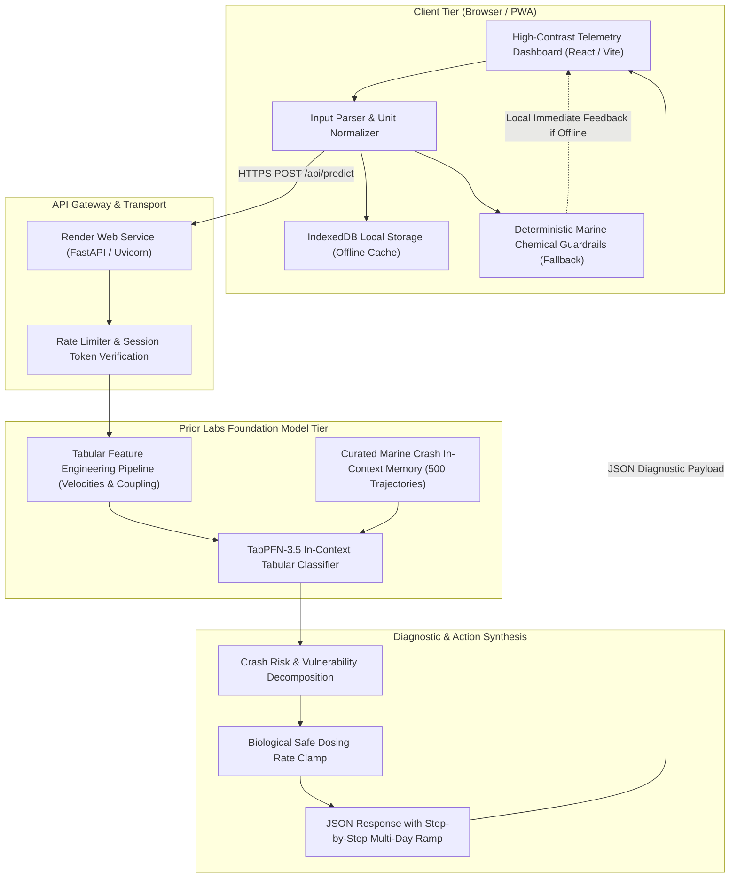
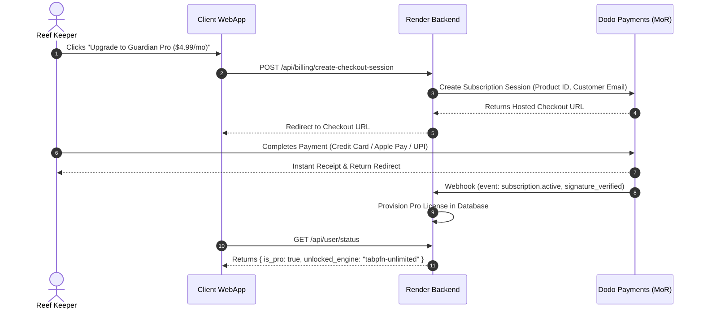

# System Architecture Specification

**System Name:** Before It Turns White  
**Subsystem:** 48-Hour Predictive Marine Chemical Crash Guard  
**Author:** Abhishek Khanra  
**Date:** October 14, 2026  
**Target Infrastructure:** Render Web Service, TabPFN-3.5 Inference API (Prior Labs)  

---

## 1. System Overview & Architectural Topology

`Before It Turns White` is an edge-hybrid, offline-capable predictive software suite. It combines a client-side reactive telemetry dashboard with a high-throughput TabPFN foundation model backend hosted on Render.



---

## 2. Component Decomposition

### 2.1 Component 1: Client Ingestion & Unit Normalizer (`client/src/normalizer.js`)
Reef hobbyists use fragmented measurement standards depending on geographical location and test kit manufacturer:
- **Salinity:** Measured in Specific Gravity ($SG$, e.g. `1.025`) or Practical Salinity Units / Parts Per Thousand ($ppt$, e.g. `35.0 ppt`).
- **Alkalinity:** Measured in German Carbonate Hardness ($dKH$, e.g. `8.3 dKH`), Milliequivalents per Liter ($meq/L$, e.g. `2.96`), or parts per million $CaCO_3$ ($ppm$, e.g. `148.5 ppm`).
- **Temperature:** Measured in Celsius ($°C$) or Fahrenheit ($°F$).

The normalizer converts all incoming test metrics into standard base units:
$$\text{Salinity (SG)} = 1 + \left( \frac{\text{Salinity (ppt)} \times 0.0008}{1.0} \right)$$
$$\text{Alkalinity (dKH)} = \text{Alkalinity (meq/L)} \times 2.804$$
$$\text{Alkalinity (dKH)} = \frac{\text{Alkalinity (ppm } CaCO_3)}{17.86}$$
$$\text{Temperature (°C)} = \frac{\text{Temperature (°F)} - 32}{1.8}$$

### 2.2 Component 2: Tabular Feature Engineering Pipeline (`backend/engine/features.py`)
TabPFN is a foundation model for tabular data. Rather than passing raw static numbers, the feature engineering pipeline constructs a multi-dimensional biological interaction matrix:

1. **Static Normalized Vector ($V_t$):**
   $$V_t = [SG, dKH, Ca, Mg, NO_3, PO_4, Temp, pH]$$

2. **Temporal Velocity ($\Delta V / \Delta t$):**
   Calculates the rate of parameter drift over 24-hour and 7-day windows:
   $$\text{Velocity}_{dKH} = \frac{dKH_t - dKH_{t-\Delta t}}{\Delta t_{\text{hours}}} \times 24$$
   *Biological Significance:* A drop of $1.5\text{ dKH}$ over two weeks is harmless; a drop of $1.5\text{ dKH}$ over 24 hours triggers immediate tissue sloughing (RTN).

3. **Ionic Coupling Index ($Mg:Ca$ Ratio):**
   $$R_{Mg:Ca} = \frac{[Mg^{2+}]}{[Ca^{2+}]}$$
   *Normal Seawater Baseline:* $1350 / 420 \approx 3.21$.  
   *Hazard Boundary:* If $R_{Mg:Ca} < 2.85$, magnesium is insufficient to prevent calcium carbonate crystal seed growth. Spontaneous abiotic precipitation of $CaCO_3$ begins within 12 to 36 hours.

4. **Aragonite Saturation State Proxy ($\Omega_{\text{arag}}^{\text{proxy}}$):**
   Corals build skeletons out of aragonite ($CaCO_3$). Skeletons begin dissolving when $\Omega < 1.0$.
   $$\Omega_{\text{proxy}} = \frac{[Ca^{2+}] \times [CO_3^{2-}]}{K'_{sp}} \propto \frac{[Ca^{2+}] \times 10^{(pH - 10.0)} \times dKH}{\text{Salinity Function}}$$

5. **Nutrient Starvation Index ($N:P$ Redfield Deviation):**
   $$R_{N:P} = \frac{[NO_3^-]}{[PO_4^{3-}] \times 16}$$
   *Biological Significance:* If $PO_4 < 0.01\text{ ppm}$ and $NO_3 < 0.5\text{ ppm}$ while Alkalinity is high ($> 9.0\text{ dKH}$), SPS corals experience "burnt tip necrosis" due to carbon-nutrient starvation.

---

### 2.3 Component 3: TabPFN-3.5 Foundation Model Tier (`backend/engine/tabpfn_agent.py`)
Prior Labs' TabPFN is a Transformer model trained on synthetic tabular datasets that performs in-context learning in a single forward pass without gradient descent or hyperparameter tuning.

```
┌────────────────────────────────────────────────────────────────────────┐
│                   TABPFN IN-CONTEXT INFERENCE MECHANISM                │
├────────────────────────────────────────────────────────────────────────┤
│ 1. Prior Context Memory (Synthetic & Curated Historical Trajectories)  │
│    - 500 validated 7-day marine parameter trajectories                 │
│    - 250 verified historical crash cases (RTN, STN, Alkalinity Drops)  │
│    - 250 verified stable balanced reef baselines                       │
├────────────────────────────────────────────────────────────────────────┤
│ 2. Target Query Ingestion                                              │
│    - Ingests the 16-dimensional engineered feature vector              │
│    - Evaluates query relative to the non-linear in-context examples    │
├────────────────────────────────────────────────────────────────────────┤
│ 3. Calibrated Output Vector                                            │
│    - P(Crash in 48h) ∈ [0.00, 1.00]                                    │
│    - Uncertainty Interval (Epistemic & Aleatoric)                      │
│    - Feature Permutation Sensitivity (Vulnerability Driver)            │
└────────────────────────────────────────────────────────────────────────┘
```

#### Why TabPFN Outperforms XGBoost and Static Rules Here
1. **Zero-Shot on Small Samples:** A typical reef tank has only 15 to 40 test entries in its history. Gradient boosted trees (XGBoost/LightGBM) overfit severely on 30 rows. TabPFN leverages its pre-trained prior to generalize accurately on ultra-sparse tables.
2. **True Multivariate Interaction:** Static warning thresholds look at numbers in isolation. TabPFN identifies that `Alk = 8.0` is safe when `Mg = 1350`, but hazardous when `Mg = 1150` and `pH = 8.35`.

---

### 2.4 Component 4: Biological Safe Dosing Rate Clamp (`backend/engine/dosing_clamp.py`)
The most common mistake made by reef keepers during a crisis is **rapid corrective overdosing**. If a keeper detects low alkalinity ($6.5\text{ dKH}$ vs target $8.5\text{ dKH}$), dumping buffer into the water spikes the pH and osmotic pressure, causing immediate coral tissue detachment.

The Safe Dosing Rate Clamp enforces maximum daily adjustment ceilings:

```
┌────────────────────────────────────────────────────────────────────────┐
│                   BIOLOGICAL RATE CLAMP SPECIFICATION                  │
├──────────────────────┬──────────────────────┬──────────────────────────┤
│ Parameter            │ Maximum Safe 24h Δ   │ Recommended Dosing Agent │
├──────────────────────┼──────────────────────┼──────────────────────────┤
│ Alkalinity           │ +0.5 dKH / 24h       │ Sodium Bicarbonate (NaHCO3)│
│ Calcium              │ +20 ppm / 24h        │ Calcium Chloride (CaCl2) │
│ Magnesium            │ +50 ppm / 24h        │ Magnesium Chloride/Sulfate│
│ Salinity             │ +0.001 SG / 24h      │ Concentrated Brine Top-Off│
│ Temperature          │ ± 1.0 °C / 24h       │ Chiller / Heater Step    │
└──────────────────────┴──────────────────────┴──────────────────────────┘
```

#### Multi-Day Schedule Generator
When the required delta $\Delta P_{\text{target}}$ exceeds the biological clamp $\Delta P_{\text{max}}$, the system automatically generates an $N$-day staggered dosing schedule:
$$N_{\text{days}} = \left\lceil \frac{|P_{\text{target}} - P_{\text{current}}|}{\Delta P_{\text{max}}} \right\rceil$$
$$\text{Daily Dose (ml)} = \frac{\text{Net Volume (L)} \times (P_{\text{target}} - P_{\text{current}})}{N_{\text{days}} \times \text{Solution Concentration}}$$

---

### 2.5 Component 5: Deterministic Marine Chemical Guardrails (Fallback)
If the user loses internet connection while standing in front of their tank, or if the TabPFN API endpoint is temporarily unreachable, the client executes a local deterministic chemical model (`client/src/guardrails.js`).

The deterministic engine evaluates three fundamental marine equilibrium conditions:
1. **The Precipitation Criterion:**
   $$\text{If } Mg < 1200\text{ ppm and } dKH > 8.0\text{ dKH and } Ca > 400\text{ ppm} \implies \text{CRITICAL PRECIPITATION HAZARD}$$
2. **The Alkalinity Shock Criterion:**
   $$\text{If } |\text{Velocity}_{dKH}| > 0.8\text{ dKH/24h} \implies \text{RAPID TISSUE NECROSIS (RTN) ALERT}$$
3. **The Nutrient Bottom-Out Criterion:**
   $$\text{If } PO_4 < 0.01\text{ ppm and } NO_3 < 0.5\text{ ppm and } dKH > 8.5\text{ dKH} \implies \text{BURNT TIP STARVATION HAZARD}$$

---

## 3. End-to-End Data Contracts (JSON Schemas)

### 3.1 Prediction Request Contract (`POST /api/predict`)

```json
{
  "tank_profile": {
    "tank_id": "tank_uuid_8941",
    "net_volume_liters": 280.0,
    "system_type": "sps_dominant",
    "dosing_method": "two_part_balling"
  },
  "current_test": {
    "timestamp": "2026-10-14T08:30:00Z",
    "salinity_sg": 1.025,
    "alkalinity_dkh": 7.8,
    "calcium_ppm": 420.0,
    "magnesium_ppm": 1180.0,
    "nitrate_ppm": 4.5,
    "phosphate_ppm": 0.04,
    "temperature_c": 25.2,
    "ph": 8.22
  },
  "history": [
    {
      "timestamp": "2026-10-12T08:30:00Z",
      "salinity_sg": 1.025,
      "alkalinity_dkh": 8.4,
      "calcium_ppm": 425.0,
      "magnesium_ppm": 1220.0,
      "nitrate_ppm": 4.2,
      "phosphate_ppm": 0.04,
      "temperature_c": 25.1,
      "ph": 8.25
    },
    {
      "timestamp": "2026-10-07T08:30:00Z",
      "salinity_sg": 1.025,
      "alkalinity_dkh": 8.6,
      "calcium_ppm": 430.0,
      "magnesium_ppm": 1290.0,
      "nitrate_ppm": 4.0,
      "phosphate_ppm": 0.03,
      "temperature_c": 25.0,
      "ph": 8.28
    }
  ]
}
```

### 3.2 Prediction Response Contract (`200 OK`)

```json
{
  "status": "success",
  "engine_used": "tabpfn-3.5-foundation",
  "evaluated_at": "2026-10-14T08:30:01.120Z",
  "risk_assessment": {
    "crash_probability_48h": 0.78,
    "risk_level": "CRITICAL_DRIFT",
    "confidence_score": 0.91,
    "primary_driver": "Magnesium Buffer Exhaustion Causing Alkalinity Destabilization",
    "secondary_driver": "Accelerated Alkalinity Velocity (-0.30 dKH/24h)"
  },
  "chemical_indicators": {
    "mg_ca_ratio": 2.81,
    "mg_ca_status": "DEFICIENT (Baseline: 3.20)",
    "alk_velocity_24h": -0.30,
    "aragonite_saturation_proxy": 3.12
  },
  "remediation_plan": {
    "target_parameters": {
      "alkalinity_dkh": 8.4,
      "magnesium_ppm": 1350.0
    },
    "rate_limited_schedule": [
      {
        "day": 1,
        "date": "2026-10-14",
        "action": "Dose Magnesium only. DO NOT DOSE ALKALINITY TODAY.",
        "chemical": "Magnesium Chloride hexahydrate solution",
        "amount_ml": 85.0,
        "expected_parameter_end_of_day": {
          "magnesium_ppm": 1230.0,
          "alkalinity_dkh": 7.8
        },
        "reasoning": "Raising Magnesium above 1250 ppm stops abiotic carbonate precipitation."
      },
      {
        "day": 2,
        "date": "2026-10-15",
        "action": "Dose Magnesium maintenance + begin gentle alkalinity ramp.",
        "chemical": "Magnesium Solution (70 ml) & Sodium Bicarbonate (25 ml)",
        "amount_ml": 95.0,
        "expected_parameter_end_of_day": {
          "magnesium_ppm": 1280.0,
          "alkalinity_dkh": 8.1
        },
        "reasoning": "Enforcing +0.3 dKH daily clamp to prevent osmotic tissue shock."
      },
      {
        "day": 3,
        "date": "2026-10-16",
        "action": "Complete target adjustment.",
        "chemical": "Magnesium Solution (70 ml) & Sodium Bicarbonate (25 ml)",
        "amount_ml": 95.0,
        "expected_parameter_end_of_day": {
          "magnesium_ppm": 1330.0,
          "alkalinity_dkh": 8.4
        },
        "reasoning": "System equilibrium restored."
      }
    ]
  }
}
```

---

## 4. Dodo Payments Subscription Architecture

To ensure full viability for an indie developer in India with international customers, the payment lifecycle is orchestrated via **Dodo Payments**:



---

## 5. Render Deployment Architecture (`render.yaml`)

The entire production stack is declaratively specified in a single Infrastructure-as-Code Blueprint:

```yaml
services:
  - type: web
    name: before-it-turns-white-api
    runtime: python
    region: oregon
    plan: starter
    buildCommand: "pip install -r requirements.txt"
    startCommand: "uvicorn backend.main:app --host 0.0.0.0 --port $PORT"
    envVars:
      - key: PYTHON_VERSION
        value: 3.11.9
      - key: PRIOR_LABS_API_KEY
        sync: false
      - key: DODO_PAYMENTS_API_KEY
        sync: false
      - key: DODO_PAYMENTS_WEBHOOK_SECRET
        sync: false
      - key: ENVIRONMENT
        value: production

  - type: web
    name: before-it-turns-white-ui
    runtime: static
    region: oregon
    plan: free
    buildCommand: "npm run build"
    staticPublishPath: "./client/dist"
    envVars:
      - key: VITE_API_BASE_URL
        value: "https://before-it-turns-white-api.onrender.com"
```

---

## 6. Verification and Regression Strategy

1. **Unit Tests (`pytest` & `vitest`):**
   - Unit normalizer verification (SG to ppt, dKH to meq/L).
   - Biological clamp boundaries (assert daily $\Delta dKH \le 0.5$).
   - Magnesium-Calcium precipitation detection boundary tests.
2. **Inference Benchmarking:**
   - 100 historical synthetic test cases passed through TabPFN client to measure latency (p95 $< 1,200\text{ ms}$).
   - Disconnection injection test: verify client falls back to local deterministic marine chemical guardrails in $< 50\text{ ms}$.
